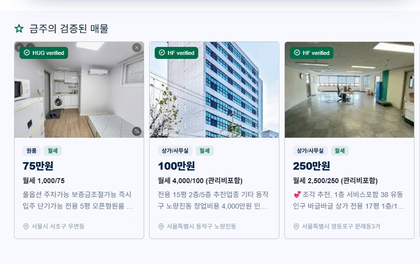

# Safe Home — 안전 매물 부동산 플랫폼

전세사기 걱정을 줄이기 위해 **HUG(주택도시보증공사) · HF(한국주택금융공사) 인증 매물**을 지도와 목록으로 한눈에 비교하는 부동산 서비스입니다.
퍼블리셔 6년 경력을 바탕으로, **Next.js App Router + Supabase**로 인증 · DB · 이미지 업로드 · 배포까지 혼자 구현했습니다.

- 🔗 배포: https://safe-home-theta.vercel.app
- 📄 소개서: [safe-home-portfolio.pdf](public/safe-home-portfolio.pdf)



<br />

## 기술 스택

| 구분 | 사용 기술 |
| --- | --- |
| Framework | Next.js 14 (App Router), React 18, TypeScript |
| Backend (BaaS) | Supabase — PostgreSQL, Auth, Storage, RLS |
| 인증 | 이메일 회원가입, 카카오 OAuth, 네이버 로그인 (Route Handler에서 세션 생성) |
| 지도 / UI | Kakao Maps SDK, Swiper, Tailwind CSS, lucide-react |
| 기타 | react-daum-postcode (주소 → 좌표), Vercel 배포 |

<br />

## 실행 방법

```bash
npm install
npm run dev
```

`.env`에 아래 값이 필요합니다. (`NEXT_PUBLIC_`이 없는 값은 서버 전용)

```
NEXT_PUBLIC_SUPABASE_URL=
NEXT_PUBLIC_SUPABASE_PUBLISHABLE_KEY=
NEXT_PUBLIC_KAKAO_MAP_KEY=
NEXT_PUBLIC_NAVER_CLIENT_ID=
NAVER_CLIENT_SECRET=
SUPABASE_SERVICE_ROLE_KEY=
```

DB 테이블 · RLS 정책 · 함수는 [supabase-properties-table.sql](supabase-properties-table.sql)을 Supabase SQL Editor에서 실행합니다.

<br />

## 주요 기능

| 기능 | 경로 | 내용 |
| --- | --- | --- |
| 메인 | `/` | 인증 매물만 골라 슬라이드로 노출, 지도 + 매물 카드, 소개 팝업(오늘 하루 보지 않기) |
| 시장 | `/home`, `/home/apt` 등 | 건물 유형 탭, 지도 가격 말풍선 ↔ 목록 카드 연동, 가격순 정렬 |
| 검색 | `/search?q=` | 제목 · 주소 · 설명 · 건물유형 통합 검색, 검색어 하이라이트 |
| 매물 상세 | `/product/[id]` | 사진 갤러리, 매물 정보, 찜하기 · 공유(카카오/네이버/링크) · 문의 |
| 매물 등록 · 수정 | `/join`, `/join/edit/[id]` | 하나의 폼으로 등록/수정, 이미지 업로드, 본인 매물만 수정 |
| 로그인 · 회원가입 | `/login`, `/login/signUp` | 역할(세입자 · 임대인 · 중개사) 선택, 약관 동의 검사, 소셜 로그인 |

- 모바일 대응: 햄버거 메뉴 + 사이드 메뉴, 지도/목록 세로 배치
- 접근성: 팝업 `role="dialog"`, ESC 닫기, 포커스 이동, 스크롤 잠금

<br />

## 폴더 구조

```
src/
├── app/                  # 페이지 (App Router)
│   ├── (main)/           # 메인 /
│   ├── home/             # 시장 — 공통 layout + 건물 유형별 페이지
│   ├── search/           # 검색 결과
│   ├── product/[id]/     # 매물 상세 (서버 컴포넌트)
│   ├── join/             # 매물 관리 · 등록 · 수정
│   ├── login/            # 로그인 · 회원가입
│   └── auth/             # 카카오 · 네이버 로그인 콜백 (Route Handler)
├── components/           # 화면별 컴포넌트 (main, home, search, product, join, layout, common)
├── services/supabase/    # client(브라우저) · server(쿠키) · admin(서버 전용) 클라이언트
├── context/              # 로그인 사용자 정보 Context
├── types/                # DB 테이블과 맞춘 타입
└── utils/price.ts        # 780000000 → "7억 8,000만원" 가격 변환
```

<br />

## 트러블슈팅

### 1. 한글 파일명 이미지 업로드 시 400 에러
Storage 경로에 원본 파일명(한글 · 공백)을 그대로 써서 발생 → `crypto.randomUUID()` + 확장자로 파일명을 새로 만들어 해결. 이름 중복 문제도 함께 해결됐습니다.

### 2. 상세 페이지에서 뒤로 가기 하면 슬라이드 카드가 늘어남
클라이언트 이동 시 CSS 로드 순서가 바뀌면서, 우선순위가 같은 Swiper 기본 스타일이 내 스타일을 덮어씀 → `.property-swiper .swiper-slide`처럼 범위를 지정해 우선순위를 높여 해결.

### 3. 네이버 로그인 세션 생성 실패
Supabase가 네이버를 기본 지원하지 않아 직접 연동 → 서버에서 `admin.generateLink`로 토큰을 발급하고 `verifyOtp({ type: "email" })`로 세션 생성. service role 키는 서버 전용 환경변수로 분리했습니다.

### 4. 팝업이 Swiper 뒤에 가려짐
`sticky` 부모가 별도의 쌓임 맥락(stacking context)을 만들어 z-index가 갇힘 → `createPortal`로 팝업을 `<body>` 바로 아래에 렌더링해 해결.

### 5. 다른 사용자가 찜하기를 누르면 권한 오류
RLS상 매물 수정은 주인만 가능 → 테이블 정책을 열지 않고, `like` 컬럼만 바꾸는 `security definer` 함수를 만들어 `rpc`로 호출.

<br />

## 앞으로 개선할 점

- [ ] 찜하기를 사용자별로 저장하도록 `likes(user_id, property_id)` 테이블 분리 (현재는 매물당 하나의 값)
- [ ] 문의 메시지 DB 저장 및 집주인 알림
- [ ] `middleware`로 로그인이 필요한 페이지 일괄 보호
- [ ] 매물 승인 / 거부 관리 로직, 마이페이지 통계 실제 데이터 연동
- [ ] 매물 수정 시 이전 이미지 Storage에서 삭제
- [ ] 여러 단어 검색, 테스트 코드 작성
